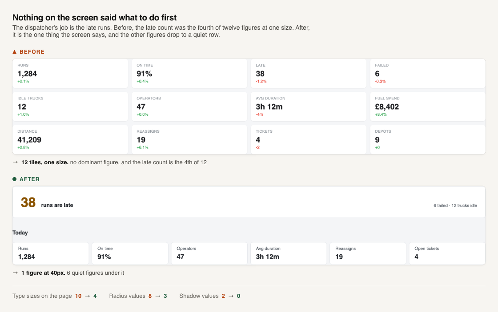
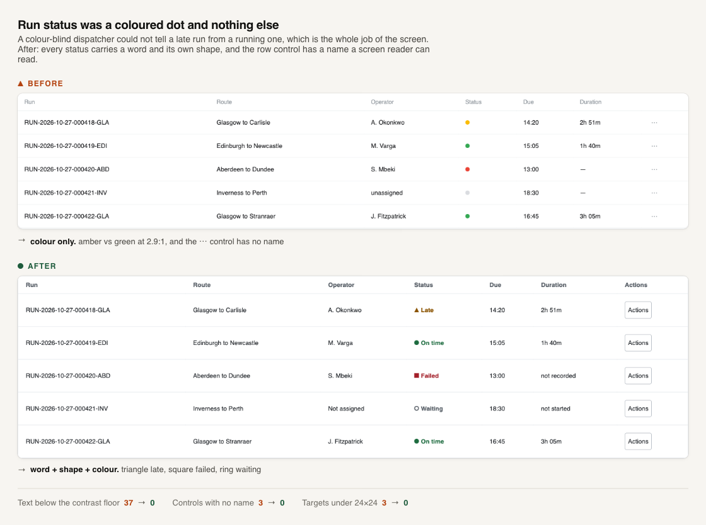
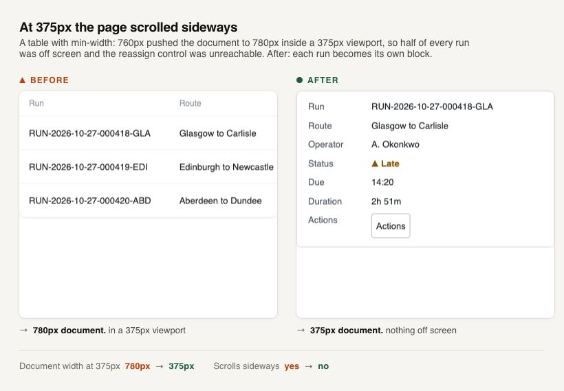
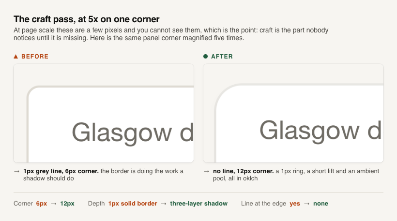
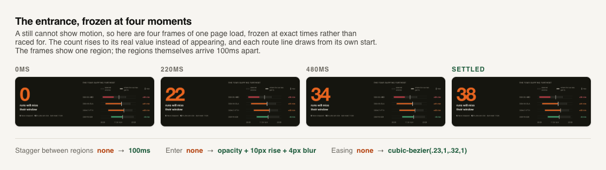
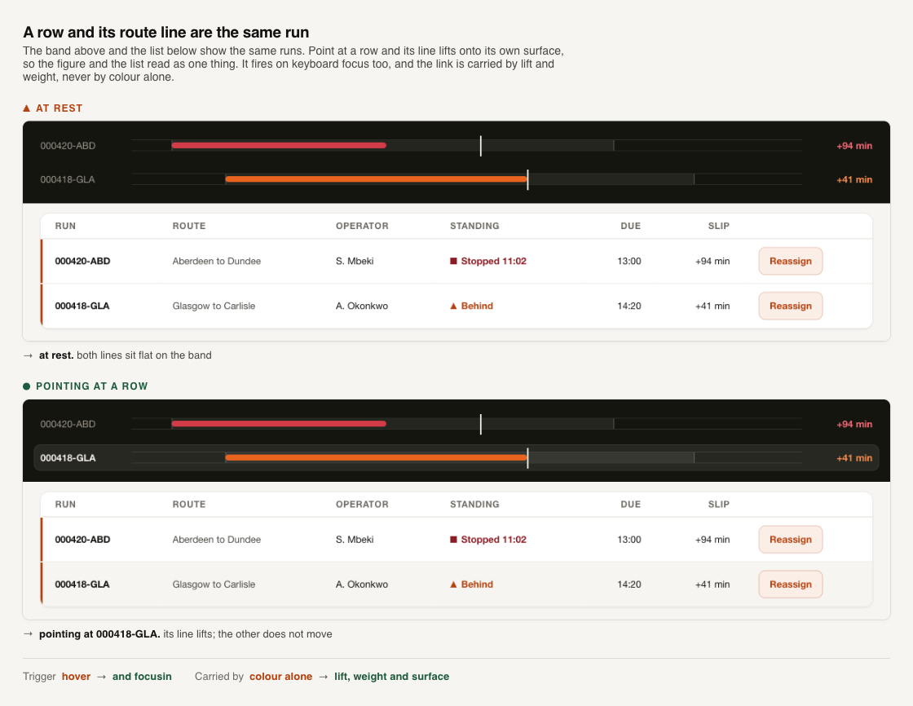
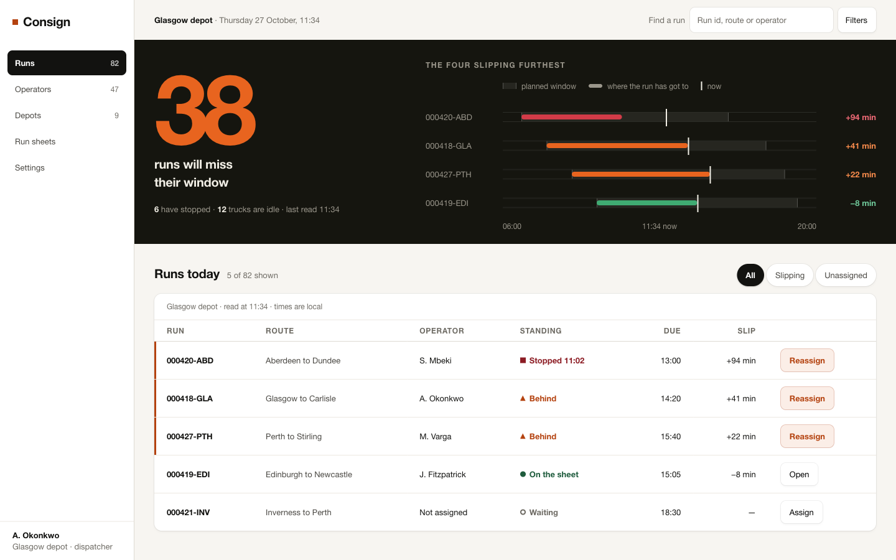
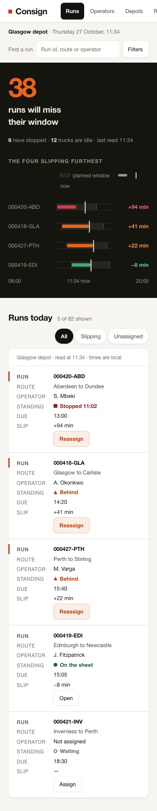
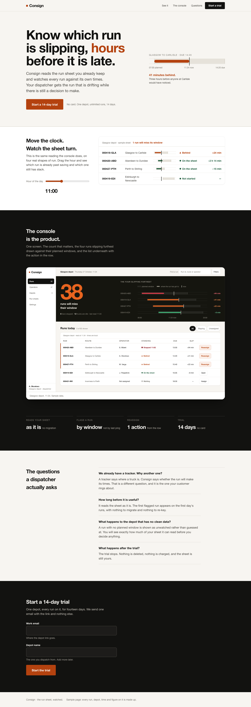

# product-experience-engineering

Agent skills for Claude Code. They make a coding agent decide what a screen
is for before writing it, and use the running product before saying the
screen works.

The problem is not that an agent cannot write frontend code. It is that an
agent writes the ticket rather than the product. It satisfies the words of a
request, never opens the result, and ships a screen that is correct and
forgettable.

## What it does

Twelve stages that scale to the size of the change. A copy edit runs three of
them. A new product runs all twelve, with the proposal agreed before any code
is written.

| | |
|---|---|
| A to C | Read what exists. Name the business outcome, the customer's job, and acceptance criteria that can be checked in a browser |
| D to F | Map the journey and every state a single fixture hides. Decide the visual direction as values. Search 508 component registries before writing a component |
| G | Build, after reading the craft rules: depth as a shadow not a border, concentric radii, ease-out under 300ms, entrances that never fire on a repeated interaction |
| H to J | Start the application, walk it as the customer with real clicks and typing, measure the render, look at every screenshot, fix in severity order |
| K to L | Run the project's own checks. Report what was verified, by what means, and what was not |

Four skills, so each can be asked for on its own:

| Skill | Say |
|---|---|
| `product-experience-engineering` | "Build the run list screen for dispatchers" |
| `component-find` | "Find me a timeline component with expandable logs" |
| `journey-walk` | "Does signup work on a phone?" |
| `experience-audit` | "Audit this dashboard". It changes no files unless asked |

## The result it is built around

A script catches what is measurable. Only looking catches the rest. Building
the demo below produced seven faults:

| Found by measuring | Found by looking |
|---|---|
| 444px page in a 375px viewport | A figure whose entire point was invisible, because the planned window and the empty track were the same grey |
| Nav links at 23px, under the 24px floor | The right half of the first screen empty while the words sat left |
| | A fix for that which stretched the grid apart and wrapped `14:20` to `14:2 / 0` |
| | Five children in a four-column grid, so a value wrapped below its row |

Four of seven were invisible to the measurement. Two were caused by an
earlier fix. That is why the skill does both, and re-runs both after every
change.

## An audit, before and after

A plausible machine-built dashboard, and the same screen after the audit's
blocker and critical findings were fixed. Both measured in a real browser at
1440 and 375.







Every number below was measured in the browser at 1440 and 375.

| | Before | After |
|---|---|---|
| Text below its contrast floor | 37 | **0** |
| Targets below 24 × 24 | 3 | **0** |
| Controls with no accessible name | 3 | **0** |
| Placeholder used as the only label | 1 | **0** |
| Heading skips | 1 | **0** |
| Text below 12px | 13 | **0** |
| Distinct type sizes / radii / shadows | 10 / 8 / 2 | **4 / 3 / 0** |
| Page width at a 375px viewport | 780px | **375px** |

The worst contrast was 2.44:1 where 4.5:1 is required. The overflow traced to
`table { min-width: 760px }`. Three things the measurement could not see. Twelve equal tiles with nothing
dominant. Status carried by a coloured dot alone. Two identical blue buttons
side by side.

## A console, before and after the craft pass

Same screen, same content, same markup structure. The right column is what
`references/craft.md` changes.

At page scale the first three of these are a few pixels each, so here is one
panel corner at 5x:



The entrance cannot be shown in a still at all. Four frames of one page load,
frozen at exact times:



| Before | After | Why |
|---|---|---|
| `1px solid` border on cards and buttons | three-layer `box-shadow` in oklch: ring, lift, ambient | A border drawn for depth reads as a line and breaks on any other surface |
| one radius everywhere | `12px` panel, `8px` control, concentric | Equal radii on nested surfaces make the inner one look pinched |
| display figure at 88px on paper | 156px on one dark band | Scale contrast is the cheapest way to make a screen read as designed |
| no motion | staged enter at 100ms per region, route lines drawing left to right, count rising to 38 | Arrival once, and never on a repeated interaction |
| hover tints the row | hover also lifts that run's route line | The row and the line are the same run |
| no `:active` | `scale(.96)` | Below `0.95` reads as a flinch |

The last row of that table is the only one that is not polish. A run row and
a route line are the same run, so pointing at either marks both:



`scale(.96)` on press has no honest still, so there is no picture of it here.

The whole screen, for context:



Every control stays reachable at 375px without sideways scrolling, and each
run becomes its own block:



## Its public page

Built on the same direction. The product's own output is the signature
element, and a live control turns the sheet as the hour moves.



Measured at 1440 and 375: 0 contrast failures, 0 targets under 24 × 24, 0
controls with no name, no sideways scroll. The whole conversion journey was
walked with real clicks and typing, with 0 console errors.

## Component discovery

Search the project first, then 508 shadcn-spec registries, with no account
and no MCP server:

```bash
node .claude/skills/product-experience-engineering/scripts/find-components.js \
  timeline stepper activity --limit 10
```

```
@uiarc     timeline   13  not stated on the site's pages that were read
    Follow what happened, newest first, grouped by day.
   deps: lucide-react, motion; files: 2
    read: pnpm dlx shadcn@latest view @uiarc/timeline
@reui      timeline   13  MIT
   deps: @base-ui/react, cn; files: 1
    read: pnpm dlx shadcn@latest view @reui/timeline
searched 24 registries for: timeline, stepper, activity
licences marked "check at the source" were not read; read one before shipping a component
```

The score is a text match, not a judgement. Candidates are then read: their
real code, states, keyboard handling, dependencies and licence. They are
ranked by fit, licence, stack, design system, accessibility and install cost,
in that order. A licence that is not stated anywhere is a blocker, not a
footnote.

## Install

```bash
git clone git@github.com:Dhodraj/product-experience-engineering.git
cp -R product-experience-engineering/.claude/skills/* ~/.claude/skills/
```

Or copy the four skill folders into any project's `.claude/skills/`.

Needs Node 20 or newer. Network for registry search, which falls back to a
cached `--curated-only` search without it. A Playwright MCP server for stages
H and I. Without one, renders fall back to headless Chrome, and every journey
claim is reported unverified.

Better with, never required: `blueprint` and `inspect` for the numeric
defaults and the render-and-look pass. `ui-ux-audit` for a deeper measuring
script. `taste-skill` for art direction on a public page. `customer-research`
for real customer evidence. Each is referenced rather than vendored.

Full instructions: [docs/install-and-invoke.md](docs/install-and-invoke.md).

## What is in here

```
.claude/skills/
  product-experience-engineering/   the entry point, 12 stages
    references/                     product thinking, visual direction, craft,
                                    journeys and states, browser, regression
    scripts/                        registry search, page measurement, validation
    tests/                          36 offline tests, 39 with --network
  component-find/  journey-walk/  experience-audit/
docs/                               research, architecture decision, testing
                                    report, examples, maintenance
demo/                               what the skill produced, and the two
                                    earlier states of it
```

Look at the demo yourself:

```bash
cd demo && python3 -m http.server 8731
# then open http://127.0.0.1:8731/console.html
```

`demo/console-plain.html` is the same console before the craft pass. Put them
side by side.

## Honesty

The reports in `docs/` separate what was read at its source from what was
inferred, and what was executed from what was not. Known gaps are written
down rather than left out:

- `pnpm dlx shadcn` was never run in the session that built this; registry
  access was proven by fetching the JSON directly.
- No component was installed into a project, and no real application with a
  dev server, sign-in and live data was driven.
- Nothing enforces the craft rules. An agent that skips that file produces
  the plain console and still passes every automated check.
- Nothing makes the agent produce three visual directions and choose among
  them, which is how `taste-skill` solves the same problem.
- Walking a journey is not customer research. It finds friction. It says
  nothing about what customers do.

Every figure, run, depot and customer in the demo is sample data, and the
pages say so on their own face.

## Licence and attribution

MIT. [NOTICE](.claude/skills/product-experience-engineering/NOTICE) records
what was adapted and from where: `ui-ux-audit-skill`, `human-experience`,
`customer-research`, `taste-skill`, `impeccable`,
`make-interfaces-feel-better` and `emilkowalski/skills`. No file from any of
them is copied; each entry says what idea was taken and how it was changed.

The reading behind every source, with its licence as read on 2026-10-27, is
in [docs/source-research.md](docs/source-research.md).
